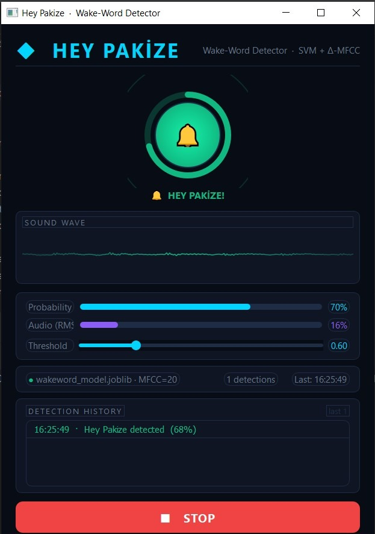

# Hey Pakize Wake-Word Detector

This project implements a real-time wake-word detection system for the phrase **"Hey Pakize"** using **MFCC features** and a **classical machine learning model (SVM)** in Python with a PyQt5 GUI interface.

<p align="center">
  
</p>

The system has four main parts:
- Dataset collection (positive and negative audio clips)
- MFCC feature extraction and CSV dataset creation
- Model training and evaluation
- Real-time inference from the microphone with live GUI

## Project structure

- `data/raw/positive/` – raw positive recordings saying "Hey Pakize"
- `data/raw/negative/` – raw negative recordings (noise, other speech, similar phrases, etc.)
- `data/processed/` – optional augmented audio
- `data/csv/` – MFCC feature tables (e.g., `mfcc_features.csv`)
- `audio/` – audio I/O, preprocessing, augmentation, feature extraction, dataset building
- `models/` – model training scripts and saved models
- `realtime/` – real-time microphone streaming and wake-word detection
- `notebooks/` – optional Jupyter notebooks for EDA and reporting
## 🛠️ Model Path Configuration
- The project automatically resolves the model path dynamically relative to the project root (`models/wakeword_model.joblib`).
- If you wish to pass a custom model file path, you can specify it as an argument when running:
  ```bash
  python -m realtime.live_interface path/to/your/model.joblib
  ```

## Environment setup

From `wakeword_project/`:

```bash
pip install -r requirements.txt
```

On Windows, you may need to run your terminal or IDE with microphone permissions enabled for `sounddevice` to work correctly.

## Basic workflow

1. **Record audio clips**
   - Positive samples (say exactly "Hey Pakize"):
     ```bash
     python -m audio.record_clips --label positive --student-id YOUR_ID --count 10
     ```
   - Negative samples (noise, other speech, similar phrases):
     ```bash
     python -m audio.record_clips --label negative --student-id YOUR_ID --count 20
     ```

2. **Optional: Run augmentation** (recommended for better generalization)
   - Generate augmented variants (noise, pitch shift, time stretch) and save to `data/processed/`:
     ```bash
     python -m audio.run_augmentation --input data/raw --output data/processed --num-variants 5
     ```
   - If you skip this, use `--base-dir data/raw` in the next step.

3. **Build MFCC CSV dataset**
   - This scans `data/processed/` (or `data/raw/`) for `positive/` and `negative/` folders, preprocesses each file, extracts MFCC statistics, and saves them:
     ```bash
     python -m audio.build_dataset --base-dir data/processed --output data/csv/mfcc_features.csv --n-mfcc 13
     ```
   - **Önerilen:** Yanlış pozitifleri azaltmak için sentetik gürültü negatifleri ekleyin:
     ```bash
     python -m audio.add_noise_negatives --csv data/csv/mfcc_features.csv --n-samples 200
     ```

4. **Train SVM wake-word model**
   - Train and evaluate the model; the best pipeline is saved to `models/wakeword_model.joblib`:
     ```bash
     python -m models.train_wakeword --csv data/csv/mfcc_features.csv --output models/wakeword_model.joblib
     ```

5. **Run real-time wake-word detection**
   - **CLI** (terminal çıktısı):
     ```bash
     python -m realtime.wakeword_client --model models/wakeword_model.joblib
     ```
   - **GUI** (PyQt5 ile grafik arayüz):
     ```bash
     python -m realtime.live_interface
     python -m realtime.live_interface models/wakeword_model.joblib
     ```

## Notes

- Ensure you have significantly more negative samples than positive ones (at least 2–3×) and include hard negatives like background noise and similar phrases.
- Keep the recording and inference sample rate/duration consistent (default: 16 kHz, ~1.0–1.2 seconds).
- For your final submission, include the **MFCC CSV** and **trained model file**, but follow your course rules about sharing raw audio.


